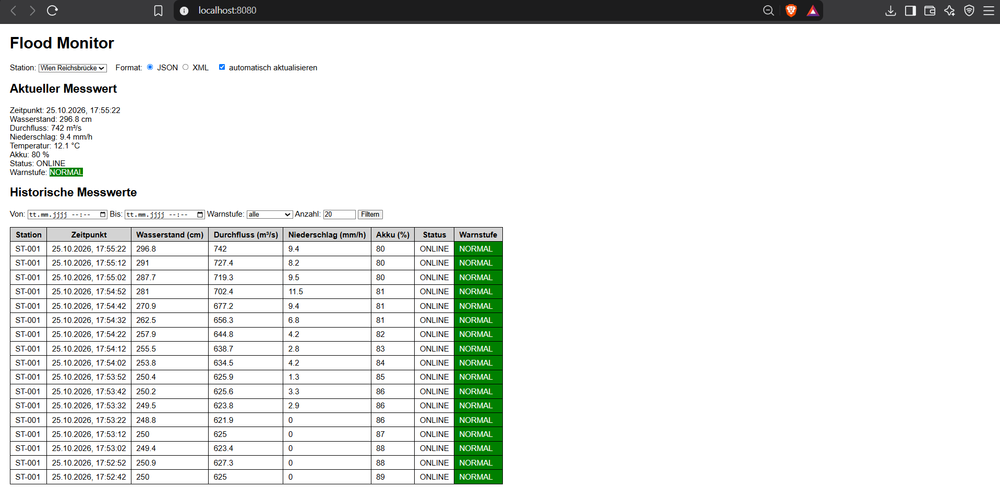
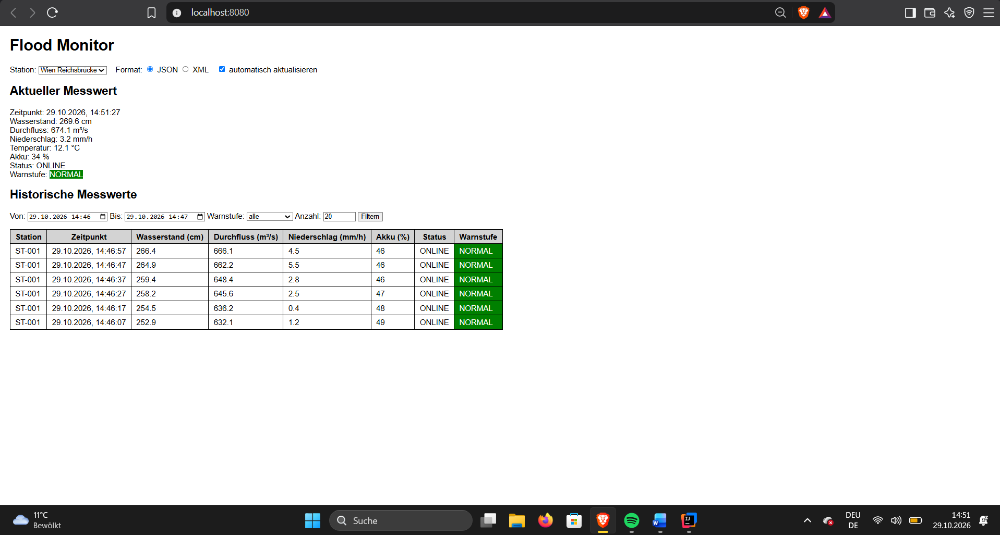
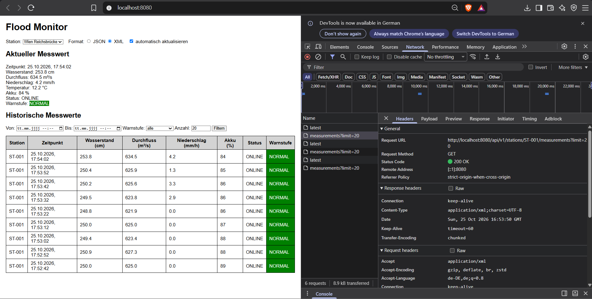
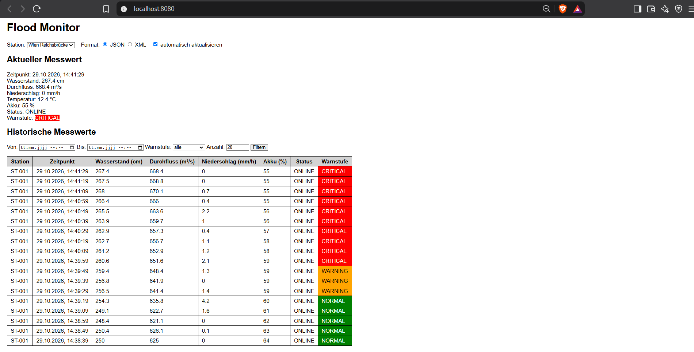
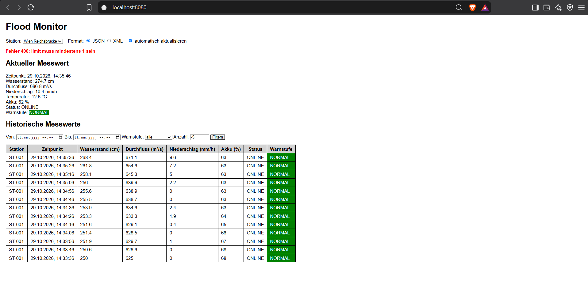

# DEZSYS GK7.1 - Flood Monitor REST

Das Projekt ist ein Hochwasser-Frühwarnsystem mit Spring Boot. Vier Messstationen an Donau, Salzach und Mur erzeugen alle 10 Sekunden neue Messwerte. Die Daten bekommt man über eine REST-Schnittstelle als JSON oder XML, und ein Webclient zeigt sie an.

Die ganze Dokumentation mit allen Screenshots ist unter [docs/KAPLAN_DEZSYS_GK71_FLOODMONITOR_REST.pdf](docs/KAPLAN_DEZSYS_GK71_FLOODMONITOR_REST.pdf).

## Projekt starten

Man braucht Java 17. In IntelliJ wird Java 17 als Projekt-SDK und als Gradle JVM eingestellt. Für das Terminal muss JAVA_HOME auf Java 17 zeigen. Danach startet man im Projektordner:

```
.\gradlew.bat bootRun
```

Die Tests startet man mit:

```
.\gradlew.bat test
```

Wenn die Anwendung läuft, erreicht man den Webclient unter http://localhost:8080, die API unter http://localhost:8080/api/v1 und die Swagger-Seite unter http://localhost:8080/swagger-ui.html.

## Konfiguration

Die Einstellungen stehen in `src/main/resources/application.properties`:

```
server.port=8080
simulation.interval=10000
simulation.enabled=true
api.key=floodmonitor-demo-key
```

Der API-Key ist nur ein Beispiel-Key für die Abgabe und kein echtes Passwort.

## Simulation

Die Simulation ist im SimulationService. Alle 10 Sekunden bekommt jede aktive Station eine neue Messung. Dabei wird immer die vorherige Messung verwendet, damit sich die Werte nur langsam ändern. Bei Regen steigt der Wasserstand, ohne Regen geht er langsam zurück zum Normalwert. Der Durchfluss ist Wasserstand x 2,5. Der Akku wird langsam leer, unter 15 % wechselt die Station auf MAINTENANCE. Graz (ST-004) ist deaktiviert und bekommt keine Messungen.

## Warnstufe

Die Warnstufe wird nur am Server berechnet:

| Bedingung | Warnstufe |
|---|---|
| Wasserstand kleiner als der Warnwert | NORMAL |
| Wasserstand ab dem Warnwert | WARNING |
| Wasserstand ab dem kritischen Wert | CRITICAL |
| keine Messung, negativer Wasserstand oder letzte Messung älter als 30 Sekunden | UNKNOWN |

## Endpunkte

| Methode | Endpunkt | Filter |
|---|---|---|
| GET | /api/v1/stations | river, isActive, warningLevel |
| GET | /api/v1/stations/{stationId} | |
| GET | /api/v1/stations/{stationId}/measurements/latest | |
| GET | /api/v1/stations/{stationId}/measurements | from, to, limit (Standard 100), warningLevel |
| GET | /api/v1/stations/{stationId}/statistics | from, to |
| GET | /api/v1/alerts | warningLevel, river |

Bei jeder Anfrage muss der Header `X-API-KEY` mitgeschickt werden. Fehlt er, kommt 401, ist er falsch, kommt 403.

## JSON und XML

Welches Format zurückkommt, entscheidet der Accept-Header. Ohne Accept-Header kommt JSON, bei einem anderen Format wie text/plain kommt 406.

JSON:

```
curl.exe -H "X-API-KEY: floodmonitor-demo-key" -H "Accept: application/json" http://localhost:8080/api/v1/stations/ST-001/measurements/latest
```

```
{"stationId":"ST-001", "timestamp":"2026-10-25T15:42:40Z", "waterLevel":286.3, "flowRate":715.7, "rainfall":4.3, "temperature":12.1, "batteryLevel":61, "status":"ONLINE", "warningLevel":"NORMAL"}
```

XML:

```
curl.exe -H "X-API-KEY: floodmonitor-demo-key" -H "Accept: application/xml" http://localhost:8080/api/v1/stations/ST-001/measurements/latest
```

```
<measurement><stationId>ST-001</stationId><timestamp>2026-10-25T15:42:40Z</timestamp><waterLevel>286.3</waterLevel><flowRate>715.7</flowRate><rainfall>4.3</rainfall><temperature>12.1</temperature><batteryLevel>61</batteryLevel><status>ONLINE</status><warningLevel>NORMAL</warningLevel></measurement>
```

## Fehlerbehandlung

Alle Fehler werden im GlobalExceptionHandler behandelt und kommen immer im gleichen Aufbau zurück, ohne Stacktrace. Zum Beispiel bei einer unbekannten Station:

```
{"timestamp":"2026-10-25T16:19:42Z", "status":404, "error":"Not Found", "message":"Station ST-999 wurde nicht gefunden", "path":"/api/v1/stations/ST-999"}
```

Bei einer ungültigen Warnstufe, einem falschen Datum, from nach to oder einem limit unter 1 oder über 1000 kommt 400.

## Webclient

Der Webclient besteht aus index.html, style.css und app.js im Ordner `src/main/resources/static`. Man kann eine Station auswählen, mit den Buttons zwischen JSON und XML umschalten und nach Zeitraum, Warnstufe und Anzahl filtern. Die Daten werden alle 10 Sekunden neu geladen.











## Aufbau

Das Projekt ist in Packages aufgeteilt: `model` (Datenklassen), `repository` (speichert die Daten im Arbeitsspeicher), `service` (Logik und Simulation), `controller` (HTTP-Anfragen), `exception` (Fehlerbehandlung) und `security` (API-Key). Die Stationen sind:

| ID | Name | Fluss | Warnung | Kritisch | Aktiv |
|---|---|---|---|---|---|
| ST-001 | Wien Reichsbrücke | Donau | 450 cm | 600 cm | ja |
| ST-002 | Linz | Donau | 550 cm | 700 cm | ja |
| ST-003 | Salzburg | Salzach | 450 cm | 600 cm | ja |
| ST-004 | Graz | Mur | 300 cm | 400 cm | nein |

## Tests

Es gibt 14 Tests in FloodMonitorApiTest. Bei den Tests ist die Simulation ausgeschaltet, damit sie nicht zufällig fehlschlagen.

## API-Dokumentation

Die API ist mit OpenAPI dokumentiert. Man sieht sie unter http://localhost:8080/swagger-ui.html, die Datei liegt unter [docs/openapi.yaml](docs/openapi.yaml).

## Reflexion

Am meisten Probleme hatte ich mit der Java-Version, weil am PC Java 8 und in IntelliJ Java 25 eingestellt war, das Projekt aber Java 17 braucht. Am Anfang hatte ich auch zu viele Service-Klassen und habe sie dann im StationService zusammengefasst. Beim API-Key hatte ich die WebConfig vergessen, und danach hat der Browser noch eine alte app.js aus dem Cache geladen. In PowerShell muss man außerdem curl.exe statt curl schreiben. Mehr dazu steht in der Dokumentation.